# Vietnamese Financial Report OCR & Intelligent Analytics Platform

[](https://www.python.org/)
[](https://pytorch.org/)
[](https://onnxruntime.ai/)
[](https://github.com/pbcquoc/vietocr)
[](https://github.com/RapidAI/RapidOCR)
[](https://openpyxl.readthedocs.io/)
[](LICENSE)

An enterprise-grade, high-performance document extraction & intelligence platform engineered to process scanned, native, and complex financial reports (Báo cáo thường niên, Báo cáo tài chính kiểm toán) into structured Markdown, tabular data, Excel spreadsheets, and provenance JSON.

The platform implements a **Hybrid Multi-Model OCR Engine**, **Vietnamese Diacritic Quality Gate**, **Multi-Column Gutter Detection & XY-Cut Reading Order**, **Selective 300-DPI Regional Fallback**, **Deterministic Pure Algorithmic Keyword Counter (Tier 1 Exact Match)**, **Corporate Excel Exporter (`count_keywords.xlsx`)**, and **Multi-Artifact Provenance Exporters**.

---

## 1. System Architecture

```mermaid
flowchart TD
    subgraph Ingestion ["1. Document Ingestion & Routing Layer"]
        PDF["Input PDF Document\n(inputs/ | examples/)"] --> INSP["PDF Quality Inspector\n(Native Text Density, Font Health, Vector Probe)"]
        INSP -->|Native Clean Text\n>=95% Confidence| NAT["Native Fast Path\n(~0.05s / page)"]
        INSP -->|Scanned / Broken Fonts / Low DPI| OCR_PATH["OCR Deep Processing Path"]
    end

    subgraph OCR_Engine ["2. Hybrid Multi-Model OCR Engine"]
        OCR_PATH --> DET["RapidOCR DBNet (ONNX Runtime)\nHigh-Speed Text BBox Detection (~0.3s/page)"]
        DET --> REC["VietOCR vgg_seq2seq Batch Engine\nDiacritic-Preserving Recognition (~0.09s/line)"]
        REC --> GATE{"Vietnamese Diacritic Gate\n(Tone Mark Density Check)"}
        GATE -->|Sufficient Diacritics| LAYOUT["Layout & Reconstruction Layer"]
        GATE -->|Suspicious Diacritic Loss| RE_OCR["Selective Regional Fallback\nRe-OCR at 250-300 DPI (<5% Pages)"]
        RE_OCR --> LAYOUT
        NAT --> LAYOUT
    end

    subgraph Layout_Reconstruction ["3. Multi-Column Layout & Reading Order"]
        LAYOUT --> GUTTER["Dynamic Gutter Detection & XY-Cut\n(2-Column / 3-Column Page Segmentation)"]
        GUTTER --> TABLE["Financial Table Synthesizer\n(Grid Detection, Multiline Merge, Pipe Tables)"]
        GUTTER --> TOPO["Natural Reading Order Sorter\n(Column-First Top-to-Bottom Flow)"]
        TABLE & TOPO --> EXP_BASE["Base Exporters\n(result.md, result.json, quality.json)"]
    end

    subgraph Keyword_Counter ["4. Pure Algorithmic Keyword Analytics Engine"]
        EXP_BASE --> T1["Tier 1: Pure Exact Matcher\nDeterministic Unicode Case-Insensitive Regex\nDirect Execution on Clean result.md"]
        T1 --> REP["KeywordReport Synthesizer\nExact Counts & Document Frequency"]
    end

    subgraph Output_Artifacts ["5. Multi-Artifact Provenance Layer"]
        REP --> XLS_OUT["count_keywords.xlsx\n(Formatted Corporate Spreadsheet with SUM Formulas)"]
        EXP_BASE --> DOC_OUT["output/<Document_ID>/\n├── result.md\n├── result.json\n├── quality.json\n├── manifest.json\n├── count_keywords.xlsx\n└── pages/ (page-0001.md, ...)"]
    end

    style PDF fill:#f9f9f9,stroke:#333,stroke-width:1.5px
    style INSP fill:#e1f5fe,stroke:#0288d1,stroke-width:1.5px
    style NAT fill:#e8f5e9,stroke:#388e3c,stroke-width:1.5px
    style DET fill:#fff3e0,stroke:#f57c00,stroke-width:1.5px
    style REC fill:#ede7f6,stroke:#512da8,stroke-width:1.5px
    style GATE fill:#fffde7,stroke:#fbc02d,stroke-width:2px
    style RE_OCR fill:#fce4ec,stroke:#c2185b,stroke-width:1.5px
    style GUTTER fill:#e8eaf6,stroke:#3f51b5,stroke-width:2px
    style T1 fill:#e0f2f1,stroke:#00796b,stroke-width:2px
    style XLS_OUT fill:#e8f5e9,stroke:#2e7d32,stroke-width:2px
    style DOC_OUT fill:#eceff1,stroke:#455a64,stroke-width:1.5px
```



---

## 2. Core Engineering & Algorithmic Highlights

### 🔹 Multi-Column Gutter Detection & XY-Cut Reading Order
Annual reports and audited financial statements frequently utilize 2-column or 3-column split layouts (e.g., FPT Annual Report). Standard OCR systems read horizontally across the entire page, resulting in jumbled sentences.
- **Dynamic Gutter Detection**: Scans continuous vertical white space corridors (gutters) while automatically excluding left/right margins.
- **XY-Cut Segmentation**: Partitions the page into distinct columns and sorts blocks in natural human reading order: column-by-column from top to bottom.
- **Anti-False-Positive Filtering**: Eliminates accidental diagram conversions (`is_diagram_page`) on sparse narrative pages and preserves executive signature sections from being distorted into tables.

### 🔹 Pure Algorithmic Keyword Counter (Tier 1 Exact Match)
Replaced legacy multi-tier / LLM architectures with 100% deterministic, high-speed algorithmic exact matching directly on the verified `result.md`:
- **Deterministic Unicode Regex**: Uses case-insensitive Unicode boundary-aware regex matching (`re.finditer` with `re.UNICODE`).
- **Zero API Cost & Zero Latency**: Complete keyword counting on 100k+ words executes in **sub-second time** on standard CPU with zero risk of hallucination or network timeouts.

### 🔹 Corporate Excel Exporter (`count_keywords.xlsx`)
Outputs keyword frequency reports in formatted Excel spreadsheets powered by `openpyxl`:
- **Executive Styling**: Corporate Navy blue header (`#1F4E79`) with white bold text, thin gridlines, and alternating read lines.
- **Automated Formula Integration**: Dynamic Excel formula `=SUM(C2:C{n})` embedded directly into the total row.
- **Dynamic Column Widths**: Automatically auto-fits column widths based on Vietnamese character lengths.

### 🔹 Dual-Path Hybrid OCR with Selective Regional Fallback
- **RapidOCR DBNet (ONNX Runtime)**: Text localization at $\sim 0.30$s per page on CPU.
- **VietOCR (vgg_seq2seq)**: Dynamic batch line recognition ($\sim 0.09$s per line) ensuring accurate Vietnamese diacritic preservation.
- **Selective Regional Fallback**: Re-renders only suspect bounding boxes at high resolution (250–300 DPI) when tone mark density is low, keeping fallback rates under **5%**.

### 🔹 Deterministic Caching & Resumption (`--resume`)
- Each processed page is cached deterministically in `.cache/<doc_hash>/`.
- If an execution is interrupted, running with `--resume` resumes instantly without re-processing completed pages.

---

## 3. Technology Stack

| Layer | Component | Technology | Version | Purpose |
| :--- | :--- | :--- | :--- | :--- |
| **Runtime & Core** | Python Runtime | Python | 3.10 / 3.11 / 3.12 | Core pipeline execution environment |
| **Deep Learning** | Tensor Framework | PyTorch | 2.0+ (CPU & CUDA) | VietOCR sequence-to-sequence recognition engine |
| **Inference Engine** | Model Acceleration | ONNX Runtime | 1.16+ | Ultra-fast DBNet text box detection on CPU |
| **OCR Models** | Detection & Recognition | RapidOCR + VietOCR | vgg_seq2seq / DBNet | Specialized Vietnamese text and boundary extraction |
| **Spreadsheet Engine** | Excel Generation | openpyxl | 3.1+ | Generates corporate-styled `count_keywords.xlsx` |
| **PDF & Image Processing**| Document Parsing | PyMuPDF (fitz) + Pillow + OpenCV | 1.23+ / 10.0+ / 4.8+ | Rendering, DPI scaling, morphological preprocessing |
| **Layout & Tables** | Reading Order & Table Merge| NetworkX / XY-Cut / Gutter Detector | Native | Multi-column topological sorting & table synthesis |
| **Command Line & Automation**| CLI Framework | Argparse + Tabulate | Native / 0.9+ | Command-line interface, batch processing, benchmarking |
| **Quality & Testing** | Testing Framework | Pytest | 7.4+ | 142 automated unit, regression, and E2E integration test cases |

---

## 4. Repository Structure

```text
OCR_pdf/
├── run_ocr.py                                   # Main CLI entry point for single document OCR & pipeline
├── config/
│   ├── profiles.yaml                            # Profiles definition (fast, balanced, accuracy)
│   └── keywords.txt                             # Default enterprise keyword search list (88 keywords)
├── docs/
│   ├── HUONG_DAN_CHAY_LENH_VA_CAC_KICH_BAN.md   # Comprehensive CLI scenario & execution guide
│   ├── bao_cao_tong_ket_nang_cap_ocr_va_bo_dem.md# Full development milestone & architecture report
│   └── E2E_KEYWORD_COUNTER_REPORT.md            # End-to-end verification and benchmark report
├── inputs/                                      # Input PDF documents directory (e.g. FPT, CLW, MSN)
├── output/                                      # Generated document artifacts (<doc_id>/)
├── scripts/
│   ├── run_count_only.py                        # Standalone sub-second keyword counter for existing result.md
│   ├── check_installation.py                    # Environment, PyTorch, ONNX, and model verification script
│   ├── setup_models.py                          # Automated model weights downloader
│   ├── setup_vietocr_model.py                   # VietOCR model downloader and validator
│   ├── smoke_test.py                            # End-to-end smoke test script
│   └── export_batch_excel.py                    # Batch run Excel summary exporter
├── src/ocr/
│   ├── application/
│   │   ├── convert_document.py                  # Primary orchestrator use case (Ingestion -> Layout -> Output)
│   │   └── count_keywords.py                    # Keyword counter orchestrator use case
│   ├── cli/
│   │   ├── run_ocr.py                           # Core argument parser & pipeline CLI runner
│   │   └── batch_runner.py                      # Multi-document batch runner with parallel workers
│   ├── domain/models/
│   │   └── keyword.py                           # KeywordCount and KeywordReport domain models
│   └── infrastructure/
│       ├── export/
│       │   ├── keyword_exporter.py              # count_keywords.xlsx Excel table exporter (openpyxl)
│       │   ├── markdown_exporter.py             # result.md Markdown exporter with anti-diagram guards
│       │   └── manifest_exporter.py             # manifest.json and quality metadata exporter
│       ├── layout/
│       │   ├── document_layout_engine.py        # Financial table synthesizer & signature block guards
│       │   └── page_content_analyzer.py         # Visual element and diagram analyzer
│       └── postprocessing/
│           ├── reading_order.py                 # Multi-column Gutter Detection & XY-Cut sorting
│           └── keyword_counter.py               # Tier-1 Pure Exact Regex Counter
├── tests/
│   ├── unit/
│   │   └── test_keyword_hybrid_counter.py       # Unit tests for exact matching and Excel export
│   └── integration/
│       └── test_keyword_counter_e2e.py          # End-to-end test verifying result.md -> count_keywords.xlsx
└── README.md                                    # Comprehensive project documentation
```

---

## 5. Getting Started & Setup Guide

### Prerequisites
- **Python**: Version `3.10`, `3.11`, or `3.12` (Khuyên dùng: **Python 3.11**)
- **RAM**: Minimum 4 GB (8 GB+ recommended for large batch processing)
- **Disk Space**: $\sim 1.5$ GB free for PyTorch CPU, ONNX Runtime, and model weights
- **OS**: Windows 10/11, Ubuntu 20.04+, macOS (Intel / Apple Silicon)

---

### Step 1: Clone Repository & Setup Virtual Environment

#### On Windows (PowerShell):
```powershell
# 1. Clone repository
git clone https://github.com/nkatu0704dataengineer/OCR_pdf_backup.git
cd OCR_pdf_backup

# 2. Create and activate virtual environment
py -3.11 -m venv .venv
.venv\Scripts\activate
```

#### On Linux / macOS:
```bash
git clone https://github.com/nkatu0704dataengineer/OCR_pdf_backup.git
cd OCR_pdf_backup
python3 -m venv .venv
source .venv/bin/activate
```

---

### Step 2: Install Dependencies & Download OCR Models

```powershell
# 1. Install required packages
pip install -r requirements.txt

# 2. Download and verify OCR model weights
python scripts/setup_models.py
python scripts/setup_vietocr_model.py
```

---

### Step 3: Run Environment Check & Smoke Test

```powershell
# 1. Verify environment and dependencies
python scripts/check_installation.py

# 2. Run automated end-to-end smoke test
python scripts/smoke_test.py
```
*Expected output:* `SMOKE TEST RESULT: PASS (All checks succeeded)`

---

## 6. Execution Scenarios & Command Cheatsheet

### 🚀 Scenario 1: Standalone Keyword Counting (Sub-Second Execution)
> **Use Case:** Count keyword occurrences on an existing `result.md` and export `count_keywords.xlsx`:

```powershell
# Count keywords on FPT 2022 (outputs count_keywords.xlsx):
python scripts/run_count_only.py FPT_Baocaothuongnien_2022

# Count keywords for another output directory:
python scripts/run_count_only.py TRA_Baocaothuongnien_2022

# Use a custom keywords file:
python scripts/run_count_only.py FPT_Baocaothuongnien_2022 --keywords-file config/custom_keywords.txt
```

---

### 🚀 Scenario 2: End-to-End OCR Pipeline Execution
> **Use Case:** Process a new PDF document, extract multi-column layout, and generate `result.md` alongside `count_keywords.xlsx`:

```powershell
python run_ocr.py inputs/FPT_Baocaothuongnien_2022.pdf
```

---

### 🚀 Scenario 3: Resuming Interrupted Processing (`--resume`)
```powershell
python run_ocr.py inputs/FPT_Baocaothuongnien_2022.pdf --resume
```

---

### 🚀 Scenario 4: Fast Page Range Inspection (`--pages`)
> **Use Case:** Inspect multi-column pages (e.g. pages 5 & 6):

```powershell
python run_ocr.py inputs/FPT_Baocaothuongnien_2022.pdf --pages 5,6
```

---

### 🚀 Scenario 5: Profile Selection for Document Quality
| Profile Flag | Target Document Type | Resolution | Typical Speed |
| :--- | :--- | :---: | :---: |
| `--profile fast` | Clean native vector PDFs, high-resolution digital text | 150 DPI | ~5 – 8 s/page |
| `--profile balanced` *(Default)* | Standard corporate annual reports & scanned documents | 180 DPI | ~11 – 14 s/page |
| `--profile accuracy` | Faded photocopies, dense tables, complex multi-column forms | 220 DPI | ~18 – 24 s/page |

```powershell
python run_ocr.py inputs/CLW_Baocaothuongnien_2020.pdf --profile accuracy
```

---

### 🚀 Scenario 6: Automated Regression Test Suite
Run the automated test suite (142 test cases):

```powershell
python -m pytest tests/ -q
```
*Expected result:* `142 passed, 2 skipped in ~4.5s`

---

## 7. License & Attribution

Developed as an **Enterprise Vietnamese OCR & Financial Document Analytics Platform**.  
Distributed under the **Apache 2.0 License**.
